# 🤖 Awesome Conversational Workflow Bot

  <strong>Curated Directory of Enterprise Conversational AI, IT Service Automation Chatbots, and Open-Source LLM Workflow Agents</strong>

  <em>Supercharge employee productivity across Slack, Microsoft Teams, Discord, and omnichannel workplaces.</em>

---

## 🧭 Table of Contents

- [📊 Sector Overview & Market Dynamics](#-sector-overview--market-dynamics)
- [💼 SaaS & Enterprise Hosted Platforms](#-saas--enterprise-hosted-platforms)
- [🛠️ Open-Source GitHub Projects](#️-open-source-github-projects)
- [🧩 Architectural Combinations & Stack Guides](#-architectural-combinations--stack-guides)
- [📈 Star History](#--star-history)
- [💖 Support & Sponsorship](#-support--sponsorship)
- [🤝 How to Contribute](#-how-to-contribute)
- [📜 Disclaimer](#-disclaimer)

---

## 📊 Sector Overview & Market Dynamics

The global conversational AI and enterprise workflow bot market is estimated at **$13.6B–$14.8B in 2025** and projected to surge past **$31.9B by 2028** (growing at a ~40% CAGR), accelerated by generative AI and autonomous multi-agent systems.

The sector is **moderately fragmented**: mega-cap CRM and ERP incumbent giants (such as Salesforce, ServiceNow, and Microsoft) capture substantial platform spend through native suites, while specialized, high-growth enterprise platforms (such as Moveworks, Kore.ai, Workato, and Ada) and vibrant open-source agentic frameworks (Dify, n8n, Langflow, and Ollama) dominate specialized IT orchestration, HR self-service, custom departmental RAG, and self-hosted privacy workflows.

---

## 💼 SaaS & Enterprise Hosted Platforms

The table below is sorted in descending order by **Company Size (Valuation / Market Cap / Revenue)**.

| Company / Product | Company Size (Valuation / Revenue) | Pricing (Starting Tier) | Free Tier / Trial Limits | Description & Key Enterprise Capabilities |
| :--- | :--- | :--- | :--- | :--- |
| **[Salesforce Slack / Slackbot](https://slack.com/)** | **~$280B+ Market Cap** ($38B+ Annual Revenue) | **$7.25 / user / month** (Pro plan, billed annually) | **Free plan forever**: 90-day message history, 1:1 huddles, up to 10 app integrations. Paid plans offer 30-day free trials. | Native workplace assistant for team workflows, reminders, and notifications. Deep bi-directional synchronization with Salesforce CRM, record approvals, and Agentforce conversational agents. |
| **[Workato Workbot](https://www.workato.com/)** | **$5.7B Valuation** (~$150M+ ARR) | **$75 / month** (Self-service Pro tier; Enterprise custom from ~$10,000/yr) | **Free trial**: 50,000 one-time starter task credits to build and execute initial recipes; no perpetual free tier. | Enterprise iPaaS and workflow automation engine with interactive Workbots for Slack and Microsoft Teams. Integrates 400+ SaaS applications with zero-code triggers and approval loops. |
| **[Moveworks](https://www.moveworks.com/)** | **$2.85B Valuation** (Acquired by ServiceNow Dec 2025; $100M+ ARR) | **~$150 / employee / year** (Enterprise licensing; custom annual quote) | **No free tier or trial**: Enterprise sales demo only; contracts typically require a minimum seat threshold of 500–1,000 employees. | Autonomous AI employee experience platform resolving IT tickets, HR inquiries, software access requests, and enterprise search queries natively within Slack and Microsoft Teams. |
| **[Kore.ai](https://kore.ai/)** | **~$1.2B Valuation** ($230M+ funding raised) | **~$60 / month** (XO Platform Essential starting tier; Enterprise custom) | **14-day free trial** for Automation AI and **30-day free trial** for Contact Center AI (includes full access to sandbox builder and test bot limits); no perpetual free tier. | Enterprise conversational AI and GenAI orchestration platform for omnichannel virtual assistants. Features dialog management, agentic workflows, and integrations with ServiceNow, SAP, and Salesforce. |
| **[Ada](https://www.ada.cx/)** | **$1.2B Valuation** ($200M+ funding raised; ~$70k median ACV) | **~$2,500 / month** (Billed annually; ~$30k/yr minimum contract) | **No free tier or trial**: Enterprise demo only; designed for organizations with >300,000 annual customer/employee conversations. | Autonomous AI service agent and customer experience workflow platform. Features conversational resolution pipelines, CRM ticketing integration, and omni-channel automated deflection. |
| **[Yellow.ai](https://yellow.ai/)** | **~$550M Valuation** (Nasdaq SPAC merger; $34M+ ARR) | **$0.99 / resolution overage** (Pay-as-you-go; Enterprise custom from ~$1,000/mo) | **Free plan forever**: 1 AI agent, up to 500 chat sessions/month, FAQ knowledge base module, and up to 2 active communication channels. | Multi-agent conversational automation platform offering enterprise self-service for customer support, HR, and IT helpdesk with voice AI, WhatsApp, Teams, and web chatbots. |
| **[Botpress](https://botpress.com/)** | **$120M Valuation** ($40M+ funding raised) | **$150 / month** (Plus plan, billed annually; or pay-as-you-go usage) | **Free plan forever**: $0/mo base, includes 25 conversations/month and $5/mo free AI token spend grant (auto-recharge packs available for overages). | Developer-centric conversational AI platform featuring visual flow construction, autonomous LLM action calling, and native integrations with Slack, Microsoft Teams, WhatsApp, and Webchat. |
| **[Leena AI](https://leena.ai/)** | **~$150M Valuation** ($40M+ funding raised) | **~$5 / employee / month** (Enterprise annual contract; custom quote) | **No free tier or trial**: Enterprise sales demo only; custom sandbox access granted during pilot evaluations. | Autonomous employee service assistant specializing in HR and IT service desk automation, onboarding journeys, knowledge synthesis, and ServiceNow/Workday/Slack orchestration. |
| **[Espressive Barista](https://www.espressive.com/)** | **~$100M Valuation** (Acquired by Rezolve AI Sep 2025) | **~$4 / employee / month** (Enterprise annual quote; typically $20k+ minimum) | **No free tier or trial**: Interactive sales demo and guided enterprise Proof of Value (PoV) only. | Virtual support agent for IT, HR, and facilities service desk operations. Provides out-of-the-box omnichannel ticket triage, automated deflection, and ServiceNow/Teams integration. |

---

## 🛠️ Open-Source GitHub Projects

The table below is sorted in descending order by **GitHub Star Count**. Every badge links directly to the repository's live stargazers page.

| Repository | GitHub Stars | License | Primary Capabilities & Workflow Focus |
| :--- | :---: | :--- | :--- |
| **[OpenClaw](https://github.com/openclaw/openclaw)** |  | MIT | Autonomous AI gateway connecting LLMs to Slack, WhatsApp, Telegram, and Discord with persistent memory, multi-channel orchestration, and scheduled tasks. |
| **[n8n](https://github.com/n8n-io/n8n)** |  | Fair-code (Sustainable Use) | Fair-code workflow automation platform with visual flow builder, 400+ nodes, LangChain AI agents, and conversational triggers for Slack, Teams, and Discord. |
| **[Ollama](https://github.com/ollama/ollama)** |  | MIT | Lightweight, privacy-preserving local LLM runner (Llama 3, Mistral, DeepSeek, Qwen) for powering private conversational workflow bots without external data egress. |
| **[Dify](https://github.com/langgenius/dify)** |  | Apache-2.0 w/ conditions | Production-ready LLM application development platform featuring visual orchestration, conversational agents, multi-model management, RAG pipelines, and API backends. |
| **[Langflow](https://github.com/langflow-ai/langflow)** |  | MIT | Visual UI framework for multi-agent systems and RAG workflows. Enables rapid drag-and-drop conversational bot construction, MCP server connectivity, and API export. |
| **[LangChain](https://github.com/langchain-ai/langchain)** |  | MIT | Leading Python/TypeScript foundation library for context-aware conversational bots, tool chaining, long-term memory, and autonomous multi-step reasoning. |
| **[AutoGen](https://github.com/microsoft/autogen)** |  | MIT | Microsoft's multi-agent framework enabling autonomous conversational agents to collaborate, write code, execute tools, and solve complex business tasks. |
| **[LiteLLM](https://github.com/BerriAI/litellm)** |  | MIT | High-throughput AI proxy gateway unifying 100+ LLMs (OpenAI, Anthropic, Bedrock, Ollama) behind a single OpenAI-compatible API with load balancing, caching, and guardrails. |
| **[CrewAI](https://github.com/crewAIInc/crewAI)** |  | MIT | Multi-agent orchestration framework for assembling autonomous AI agents into collaborative crews with role playing, shared memory, and task delegation. |
| **[Flowise](https://github.com/FlowiseAI/Flowise)** |  | Apache-2.0 | Drag-and-drop visual UI for building custom LLM flows, RAG assistants, and interactive chatbots with LangChainJS and LlamaIndex backends. |
| **[LlamaIndex](https://github.com/run-llama/llama_index)** |  | MIT | Data framework connecting custom enterprise data sources (databases, docs, APIs) to LLMs for accurate, context-rich conversational Q&A and workflow execution. |
| **[Huginn](https://github.com/huginn/huginn)** |  | MIT | Event-driven automation system for building web agents that monitor URLs, handle webhooks, execute automated scripts, and send alerts to Slack and Teams. |
| **[LocalAI](https://github.com/mudler/LocalAI)** |  | MIT | Self-hosted, drop-in replacement for OpenAI API running models locally on CPU and GPU without commercial cloud vendor dependencies. |
| **[Rocket.Chat](https://github.com/RocketChat/Rocket.Chat)** |  | MIT | Open-source enterprise team communication platform with integrated bot engine, omnichannel livechat, slash commands, and webhook automations. |
| **[Mattermost](https://github.com/mattermost/mattermost)** |  | MIT (Core) | Secure open-source collaboration platform with DevOps playbooks, bot accounts, slash commands, and workflow orchestration tailored for technical teams. |
| **[Khoj](https://github.com/khoj-ai/khoj)** |  | AGPL-3.0 | Personal AI assistant and knowledge coworker with deep desktop/web search, automations, WhatsApp/Discord integration, and local LLM connectivity. |
| **[Danswer (Onyx)](https://github.com/danswer-ai/danswer)** |  | MIT | Enterprise AI search and conversational assistant with connectors for Slack, Google Drive, Jira, Confluence, and ServiceNow with strict role-based access control. |
| **[Semantic Kernel](https://github.com/microsoft/semantic-kernel)** |  | MIT | Microsoft's enterprise-grade SDK for integrating LLMs with conventional programming languages (C#, Python, Java) using plugins, planners, and memories. |
| **[Haystack](https://github.com/deepset-ai/haystack)** |  | Apache-2.0 | End-to-end LLM orchestration framework by deepset for building customizable, production-scale RAG pipelines, agentic workflows, and semantic search systems. |
| **[Activepieces](https://github.com/activepieces/activepieces)** |  | MIT (Core) | Open-source no-code workflow automation platform with 200+ integrations, native AI piece actions, and seamless event triggers for Slack and enterprise CRMs. |
| **[OpenAI Swarm](https://github.com/openai/swarm)** |  | MIT | Experimental, ergonomic multi-agent orchestration framework demonstrating agent coordination, function calling handoffs, and conversational routing. |
| **[Rasa](https://github.com/RasaHQ/rasa)** |  | Apache-2.0 | Robust conversational AI framework offering fine-grained natural language understanding (NLU), dialogue management, and custom Python action server integrations. |
| **[WrenAI](https://github.com/Canner/WrenAI)** |  | AGPL-3.0 | GenBI and text-to-SQL agent converting natural language questions into accurate SQL queries, data charts, and automated reporting bot messages for Slack and Teams. |
| **[Botpress Core](https://github.com/botpress/botpress)** |  | AGPL-3.0 / Fair-source | Modular open-source conversational platform featuring visual dialogue tree modeling, custom NLU, code execution hooks, and multi-channel adapters. |
| **[Typebot](https://github.com/baptisteArno/typebot.io)** |  | AGPL-3.0 | Open-source conversational form and chatbot builder with an intuitive visual flow builder, Docker self-hosting, and integrations with Slack and WhatsApp. |

---

## 🧩 Architectural Combinations & Stack Guides

Build your own self-hosted, vendor-independent enterprise conversational stack:

*   **Visual Interface & Builder**: [Dify](https://github.com/langgenius/dify), [Langflow](https://github.com/langflow-ai/langflow), or [Flowise](https://github.com/FlowiseAI/Flowise) for visual prompt chaining, dialogue nodes, and agent configurations.
*   **Dialogue & Orchestration**: [Rasa](https://github.com/RasaHQ/rasa), [CrewAI](https://github.com/crewAIInc/crewAI), or [AutoGen](https://github.com/microsoft/autogen) for multi-agent collaboration and state management.
*   **Enterprise Integration & Webhooks**: [n8n](https://github.com/n8n-io/n8n) or [Activepieces](https://github.com/activepieces/activepieces) for integrating 400+ SaaS tools, Jira tickets, and ServiceNow tables.
*   **Enterprise Knowledge & RAG**: [Danswer (Onyx)](https://github.com/danswer-ai/danswer) or [LlamaIndex](https://github.com/run-llama/llama_index) for vectorized document retrieval across Confluence, Google Drive, and Notion.
*   **Inference & Security**: [Ollama](https://github.com/ollama/ollama) or [LocalAI](https://github.com/mudler/LocalAI) paired with [LiteLLM](https://github.com/BerriAI/litellm) for private, zero-data-leakage on-premises model hosting.

---

## 📈 Star History

---

## 💖 Support & Sponsorship

If you find this curated directory useful for your organization, IT team, or engineering project, please consider supporting the project:

- ⭐ **Star this repository** to help others discover it!
- 🍴 **Fork the repo** to contribute new tools and ecosystem updates.
- 📣 **Share with your colleagues** on LinkedIn, X/Twitter, or Reddit.
- ☕ **Buy a coffee & sponsor**: Support ongoing research and maintenance via the [GitHub Sponsor Dashboard](https://github.com/sponsors/ishandutta2007).

---

## 🤝 How to Contribute

1. Fork this repository.
2. Add or update entries in [README.md](file:///C:/Users/ishan/Documents/Projects/Awesome-Conversational-Workflow-Bot/README.md).
3. Ensure entries include verifiable pricing details, free tier/trial boundaries, company valuation/revenue metrics, and proper GitHub star badges.
4. Submit a Pull Request with a clear description of the additions.

---

## 📜 Disclaimer

- This list is community-curated for informational, technical, and educational purposes.
- Mentions do not constitute commercial endorsement or warranty.
- Always verify data privacy and security compliance (SOC 2, ISO 27001, HIPAA, GDPR) prior to deploying conversational bots with corporate data.

---

  Maintained with ❤️ for the open conversational AI &amp; enterprise workflow automation community.

